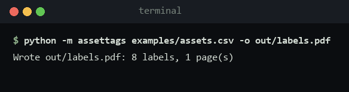

# asset-tag-label-generator

[](https://github.com/yassine2med/asset-tag-label-generator/actions/workflows/ci.yml)  

Equipment in a building is hard to track when nobody can tell which unit is which. A printed label with a QR code lets a technician scan the unit and open the right record. This tool reads a CSV of assets and writes a PDF sheet of labels, three across and eight down on US Letter paper (2.5 by 1.25 inch each), with the asset ID, name, building and location printed next to the QR code.



## What it is for

Equipment in a building is hard to track when nobody can tell which unit is which. Facility coordinators, maintenance technicians and asset managers use this tool to print QR labels for air handlers, pumps, panels and other equipment from an asset list. They get a ready PDF label sheet, and a technician can scan any unit to read its asset ID.

## Install

```
git clone https://github.com/yassine2med/asset-tag-label-generator
cd asset-tag-label-generator
pip install -r requirements.txt
```

## How to use

| I want to | Command |
|---|---|
| Make a label sheet from an asset CSV (writes labels.pdf in the current folder) | `PYTHONPATH=src python -m assettags examples/assets.csv` |
| Choose the output PDF path (the folder is created if needed) | `PYTHONPATH=src python -m assettags examples/assets.csv -o out/labels.pdf` |
| Show help | `PYTHONPATH=src python -m assettags --help` |

Input columns: `asset_id` (format like `HVAC-0001`), `name`, `building`, `location`. The QR code holds the text `ASSET:<asset_id>`.

Example:

```
PYTHONPATH=src python -m assettags examples/assets.csv -o out/labels.pdf
```

Output:

```
Wrote out/labels.pdf: 8 labels, 1 page(s)
```

Run the tests with `python -m pytest -q`.

## How it works

1. The CSV is read and each `asset_id` is checked against the pattern two to four capital letters, a dash and four digits. Any bad row stops the run with its row number.
2. Label positions come from a fixed grid; index 0 is the top left cell and a new page starts after 24 labels.
3. The QR code is drawn with the QR widget in reportlab and scaled to one inch.
4. Long names, buildings and locations are cut to 20 characters and end with three dots.
5. The PDF is written, creating the output folder if needed.

## Limits

- One fixed label size and grid. There is no template for other label stock.
- The QR code holds only the asset ID text. It does not link to a website.
- The border is drawn for alignment checks; print on plain paper first to test your printer margins.

## License

MIT. Yassine Emhamed, 2026.
